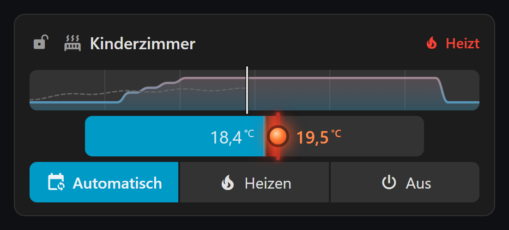
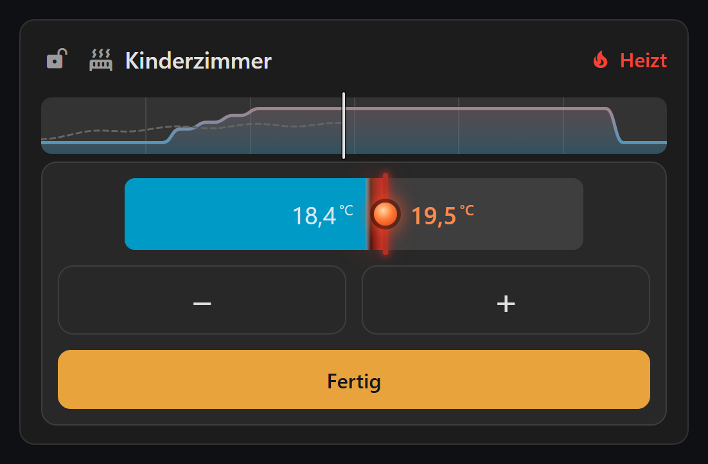

# Thermostat Bar Card

Waagerechte Thermostat-Karte für Home Assistant. Die Füllung zeigt die Ist-Temperatur, die farbige Fläche bis zur Markierung die Heizanforderung, und die ziehbare Markierung setzt die Solltemperatur.

Entstanden, weil die eingebaute Thermostat-Karte ihren Rundregler zugleich als Bedienfläche nutzt: Wird sie flach genug für ein Dashboard, ist sie am Telefon nicht mehr zu treffen. Eine Leiste trennt beides — sie bleibt flach und behält fingergerechte Bedienflächen.



## Bedienung

Die Leiste in der Karte ist **reine Anzeige**. Sie fängt keine Wischgeste ab, deshalb lässt sich über einem Dashboard voller solcher Karten ungestört scrollen, ohne versehentlich eine Temperatur zu verstellen.

- **600 ms halten** öffnet den Bearbeitungsmodus. Bewegt sich der Finger vorher um mehr als sechs Pixel, bricht die Geste ab.
- Im Bearbeitungsmodus erscheint dieselbe Leiste noch einmal, dort **ziehbar**, darunter große **Plus- und Minus-Flächen** und ein **Fertig**-Knopf.
- Schließen durch Tippen daneben oder über **Fertig**.
- Über Tastatur: Leiste fokussieren, dann Eingabe oder Leertaste.



## Installation

### Über HACS

1. HACS öffnen, oben rechts das Menü, **Custom repositories**
2. `https://github.com/SvMo85/ha-thermostat-bar-card` eintragen, Kategorie **Dashboard**
3. Die Karte herunterladen
4. Browser mit Strg+Shift+F5 neu laden

### Von Hand

1. `dist/thermostat-bar-card.js` nach `config/www/` kopieren
2. Unter Einstellungen > Dashboards > Ressourcen eintragen:
   `/local/thermostat-bar-card.js` als **JavaScript-Modul**
3. Browser neu laden

## Verwendung

Eine Karte mit nur `type` und `entity` ist vollständig funktionsfähig. Minimum, Maximum und Schrittweite liest die Karte aus der Entität.

```yaml
type: custom:thermostat-bar-card
entity: climate.thermostat_kinderzimmer
```

Mit allen gebräuchlichen Optionen:

```yaml
type: custom:thermostat-bar-card
entity: climate.thermostat_kinderzimmer
name: Kinderzimmer
icon: mdi:radiator
lock_entity: lock.thermostat_kinderzimmer_button_lock
height: 44
edit_height: 56
edge_space: 60
tolerance: 0.2
show_labels: true
show_status: true
show_icons: true
show_mode_labels: true
hvac_modes:
  - mode: auto
  - mode: heat
    label: ""
  - mode: "off"
    label: Aus
colors:
  current: "#4a7f9e"
  demand: "#7d4226"
  target: "#e8a33d"
```

## Konfiguration

| Schlüssel | Vorgabe | Wirkung |
|---|---|---|
| `entity` | — | Klima-Entität, Pflichtfeld |
| `name` | Name der Entität | Überschrift der Karte |
| `icon` | `mdi:radiator` | Symbol vor dem Namen. Leer lassen, um es wegzulassen |
| `lock_entity` | — | Entität der Bedienungssperre. Fehlt sie, erscheint kein Schloss |
| `height` | `44` | Höhe der Anzeigeleiste in Pixel, entspricht der Knopfhöhe |
| `edit_height` | `56` | Höhe der Leiste im Bearbeitungsmodus |
| `edge_space` | `60` | Freier Rand links und rechts, in den die Beschriftungen auswandern dürfen |
| `tolerance` | `0.2` | Ab welcher Abweichung in Kelvin der Status auf "Erreicht" wechselt |
| `show_labels` | `true` | Ist- und Soll-Werte in der Leiste |
| `show_status` | `true` | Statusanzeige oben rechts |
| `show_icons` | `true` | Symbole auf den Modus-Knöpfen |
| `show_mode_labels` | `true` | Text auf den Modus-Knöpfen |
| `hvac_modes` | alle vom Gerät gemeldeten | Welche Knöpfe erscheinen und in welcher Reihenfolge |
| `schedule` | siehe unten | Tagesplan des Heizprofils über der Leiste |
| `colors` | siehe unten | Farben der Karte |

Minimum, Maximum und Schrittweite sind bewusst **nicht** konfigurierbar. Sie stammen aus `min_temp`, `max_temp` und `target_temp_step` der Entität, damit die Leiste nie etwas anbietet, das das Gerät nicht annimmt.

### hvac_modes

Entweder als einfache Liste von Modusnamen, oder ausführlich mit eigener Beschriftung und eigenem Symbol:

```yaml
hvac_modes:
  - mode: auto
    label: Automatik
    icon: mdi:calendar-clock
  - mode: heat
    label: ""          # leer lassen: nur das Symbol
  - mode: "off"
```

Ohne `label` nimmt die Karte die Übersetzung von Home Assistant und folgt damit der eingestellten Sprache. Sind `label` leer und `show_icons: false`, bliebe der Knopf leer — in dem Fall zeigt die Karte den Text.

### Tagesplan

Über der Leiste zeigt die Karte auf Wunsch den heutigen Tagesplan des Heizprofils als Kurve: Die Höhe zeigt die Temperatur, ein senkrechter Strich die aktuelle Uhrzeit, feine Marken alle vier Stunden. Dazu kommen:

- **Abweichungen vom Plan** als gestrichelte Linie mit Beschriftung. Im Automatikbetrieb endet eine manuell gesetzte Temperatur am nächsten Schaltpunkt, weil Homematic IP dann ins Profil zurückkehrt. Heizen und Aus gelten bis zum Tagesende.
- **Der gemessene Verlauf** der Ist-Temperatur von 0 Uhr bis jetzt, aus dem Verlauf von Home Assistant.

Der Plan stammt aus dem Attribut `schedule_data`, das die Integration [Homematic(IP) Local](https://github.com/SukramJ/homematicip_local) an jeder Klima-Entität bereitstellt. Fehlt das Attribut, blendet die Karte den Tagesplan aus.

```yaml
schedule:
  show: true
  min_temp: 16
  max_temp: 24
  min_color: primary
  max_color: red
  show_history: true
  history_color: secondary-text
```

| Schlüssel | Vorgabe | Wirkung |
|---|---|---|
| `show` | `false` | Tagesplan anzeigen |
| `min_temp` | `16` | Temperatur, die die Farbe `min_color` bekommt |
| `max_temp` | `24` | Temperatur, die die Farbe `max_color` bekommt |
| `min_color` | `primary` | Farbe am unteren Ende der Farbskala |
| `max_color` | `red` | Farbe am oberen Ende der Farbskala |
| `show_history` | `true` | Gemessenen Verlauf bis jetzt zeigen |
| `history_color` | `secondary-text` | Farbe des Verlaufs, gedämpft gezeichnet |

`min_temp` und `max_temp` bestimmen nur die **Farben**: Dieselbe Temperatur hat damit auf jeder Karte dieselbe Farbe, dazwischen wird gemischt. Die **Höhe** der Kurve rechnet die Karte selbst aus: unten der kleinste Wert der Wochenpläne, oben der größte oder ein höherer Sollwert, mit je 0,5 °C Luft.

Farben nehmen Theme-Farbnamen von Home Assistant wie `primary`, `red` oder `secondary-text` an und folgen damit dem Theme. Jede andere CSS-Farbangabe wie `#ff9800` geht ebenso.

### Farben

Jeder Wert nimmt eine beliebige CSS-Farbangabe an, also auch Theme-Variablen wie `var(--primary-color)`. Die Vorgaben nutzen die Theme-Farben `--primary-color` für alles, was Ist und Automatik betrifft, und `--red-color` für alles, was heizt.

| Schlüssel | Vorgabe | Wirkung |
|---|---|---|
| `track` | `var(--divider-color)` | Hintergrund von Leiste, Tagesplan und Knöpfen |
| `current` | `var(--primary-color)` | Füllung bis zur Ist-Temperatur |
| `demand` | Glut-Verlauf aus `current` und `demand_glow` | Fläche zwischen Ist und Soll. Nimmt jeden CSS-Hintergrund, auch Verläufe |
| `target` | `#e8a33d` | Strich und Greifpunkt |
| `demand_glow` | `var(--red-color)` | Warmer Schein unter der Heizanforderung, Grundton des Glut-Verlaufs |
| `target_heating` | `demand_glow`, abgedunkelt | Strich hinter der Kugel, solange das Gerät heizt |
| `label_current` | `#dde7ee` | Ist-Beschriftung |
| `label_target` | `#e8a33d` | Soll-Beschriftung |
| `status_heating` | `var(--red-color)` | Status, solange geheizt wird |
| `status_reached` | `var(--primary-color)` | Status, wenn die Solltemperatur erreicht ist |
| `status_idle` | `var(--secondary-text-color)` | Status sonst |
| `mode_auto` | `var(--primary-color)` | Knopf Auto, ausgewählt |
| `mode_heat` | `var(--red-color)` | Knopf Heizen, ausgewählt |
| `mode_off` | `#3d5f7a` | Knopf Aus, ausgewählt |
| `mode_inactive` | `var(--divider-color)` | Rand der nicht ausgewählten Knöpfe beim Überfahren |
| `lock_active` | `#c06a6a` | Schloss, wenn die Bedienung gesperrt ist |

Bis Version 0.2 nutzte die Karte Petrol und Glut-Orange. Wer diese Farben behalten will:

```yaml
colors:
  current: "#2b8a9a"
  demand_glow: "#e8663d"
  target_heating: "#c23a1a"
  status_heating: "#e8663d"
  status_reached: "#4caf50"
  mode_auto: "#4caf50"
  mode_heat: "#e8663d"
```

## Was die Farben bedeuten

Die Karte trennt zwei Aussagen, die bei Thermostaten oft auseinanderlaufen:

- **Die Glutfläche** zwischen Ist und Soll zeigt, wie viel Wärme noch fehlt. Sie folgt allein der Differenz und bleibt auch sichtbar, wenn die Heizung gerade aus ist.
- **Die glühende Kugel** samt rotem Strich und der Status oben rechts zeigen, ob das Gerät gerade heizt. Sie folgen `hvac_action` der Entität. Meldet ein Gerät diesen Wert nicht, dient die Differenz als Ersatz.

Beides kann auseinanderlaufen: Nach einer Absenkung fährt ein Ventil allmählich zu und meldet so lange weiter "heizt", obwohl der Sollwert bereits unter der Ist-Temperatur liegt. Dann glüht die Kugel, aber es erscheint keine Fläche.

## Hinweis zu Homematic IP

Die Karte ändert beim Verstellen der Temperatur **nicht** den Betriebsmodus. Das ist Absicht: Homematic-IP-Thermostate behalten einen im Automatikbetrieb gesetzten Wert bis zum nächsten Schaltzeitpunkt des Heizprofils bei und kehren danach ins Profil zurück. Wer einen Wert dauerhaft halten will, schaltet über den Knopf auf Heizen.

Die Bedienungssperre am Gerät ist bei Homematic IP ein eigener Geräteparameter und keine Eigenschaft der Klima-Entität. Die passende Schalter-Entität gehört deshalb in `lock_entity`.

## Lizenz

MIT
